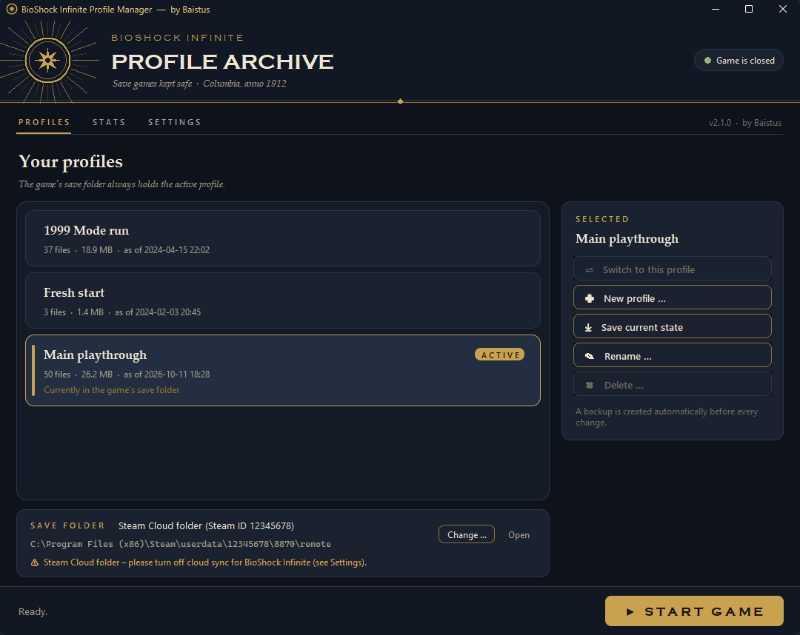

# BioShock Infinite Profile Manager

**von Baistus** · [English version](README.md)

Ein kleines Windows-Tool für **BioShock Infinite** (Steam, App-ID 8870):

- **Profile:** Du verwaltest mehrere unabhängige Spielstände. Das Spiel kennt nur einen Spielstand und überschreibt ihn bei „Neues Spiel“. Das Tool sichert den Save-Ordner pro Profil und tauscht ihn beim Wechseln aus.
- **Spielwerte-Editor (experimentell):** Du siehst und änderst **Infusionen** (Leben, Schild, Salze), **Silberadler** und **Dietriche** direkt im Spielstand.

Vor jeder Änderung entsteht ein Backup. Die Oberfläche gibt es auf **Deutsch und Englisch**.



---

## ⚠ Wichtig: Steam Cloud abschalten

Bevor du das Tool benutzt, schalte die Steam Cloud für BioShock Infinite aus. Sonst kann Steam deine Profile überschreiben:

1. Steam öffnen → **Bibliothek**
2. Rechtsklick auf **BioShock Infinite** → **Eigenschaften …**
3. Reiter **Allgemein** → **„Spielstände in der Steam Cloud speichern“** ausschalten

**Warum:** Das Tool tauscht die Dateien im Save-Ordner aus. Mit aktiver Cloud kann Steam beim nächsten Start ältere Cloud-Stände zurückspielen.

---

## Download und Start

- **Am einfachsten:** Lade `BioShockProfileManager.exe` von der Seite [Releases](../../releases) und starte sie. Du brauchst weder Installation noch Python.
  - Die `.exe` ist nicht signiert. Beim ersten Start kann Windows SmartScreen deshalb warnen. Klicke dann auf „Weitere Informationen“ und anschließend auf „Trotzdem ausführen“.
- **Aus dem Quellcode:** Du brauchst Windows und Python 3.8+ (von python.org, Tkinter ist dabei). Weitere Pakete sind nicht nötig.

  ```bat
  python bioshock_profiles.py
  ```

## Profile

| Aktion | Was passiert |
|---|---|
| **Neues Profil …** | Das Tool legt ein Backup an und sichert den aktuellen Stand ins aktive Profil. Danach leert es den Save-Ordner, und das Spiel bietet ein neues Spiel an. |
| **Wechseln** (oder Doppelklick) | Backup, aktuellen Stand sichern, dann das gewählte Profil in den Save-Ordner kopieren. |
| **Aktuellen Stand sichern** | Kopiert den Save-Ordner ins aktive Profil. |
| **Umbenennen … / Löschen …** | Vor dem Löschen kommt eine Rückfrage und es wird ein Backup angelegt. Das aktive Profil lässt sich nicht löschen. |
| **Spiel starten** | Öffnet `steam://rungameid/8870`. |

Solange `BioShockInfinite.exe` läuft, sind Wechseln, „Neues Profil“ und das Bearbeiten gesperrt. Beim ersten Start übernimmt das Tool deinen vorhandenen Spielstand als Profil **„Standard“**.

## Spielwerte-Editor (experimentell)

Wähle ein Profil und einen Spielstand. Vorausgewählt ist der neueste Autosave, den das Spiel über **Fortsetzen** lädt.

- **Infusionen:** Jeder Wert hat 0–10 Stufen. Du stellst sie mit **− / +** oder per Klick auf die Rauten ein.
  - Im Hauptspiel gibt es **24 Infusionen**, **29 mit Season Pass**. Alle drei Werte voll auszubauen würde 30 brauchen. Im normalen Spiel geht das also nicht.
  - Ein voller Wert lässt sich bei der nächsten Infusion nicht mehr wählen.
  - Stehen **alle drei auf Maximum**, kannst du Infusionen voraussichtlich gar nicht mehr aufnehmen. Am **Blue Ribbon** kann das Spiel dann hängen bleiben, weil die Kellnerin erst weitergeht, wenn du die Infusionen genommen hast. Das Tool warnt davor. Solange du noch Infusionen einsammelst, lass besser einen Wert auf 9.
- **Silberadler:** 0–99.999. Du tippst die Zahl ein oder nutzt die Schritt-Buttons.
- **Dietriche:** 0–999. Normal sind bis zu 30, darüber warnt das Tool (Trainer-Bereich).
- **Salze im Vorrat** zeigt das Tool nur zur Info an.

Werte über dem Maximum, etwa Leben-Stufe 1000, stammen in der Regel von Trainern oder Cheats. Das Tool zeigt sie an, und du kannst sie korrigieren.

**So arbeitet der Editor:**
- Er ändert nur diese Felder im Spielerzustand.
- Die Datei bleibt gleich groß und behält ihren Zeitstempel. Die MD5-Prüfsumme wird neu berechnet.
- Vor dem Speichern prüft er das Ergebnis durch erneutes Einlesen und legt ein Backup der Originaldatei unter `_backups\…_Spielwerte\` an.
- Das Format ist aus echten Spielständen erschlossen und nicht offiziell dokumentiert.
- Das Feld für Silberadler ist bestätigt. Das Feld für Dietriche ist per Analyse ermittelt: **Bitte melde dich, falls im Spiel eine andere Dietrich-Zahl erscheint.**

**Grenzen:**
- Unterstützt wird nur das Hauptspiel, nicht *Burial at Sea*.
- Eine Infusion lässt sich erst ändern, wenn du im Spiel mindestens einmal eine Infusion dieses Typs gewählt hast.

## Wo liegt was?

| Was | Ort |
|---|---|
| Save-Ordner (automatisch erkannt) | `Steam\userdata\<Steam-ID>\8870\remote` oder `Dokumente\My Games\BioShock Infinite\SaveData` |
| Profile | `Dokumente\BioShockProfiles\<Profilname>\` |
| Backups | `Dokumente\BioShockProfiles\_backups\<Zeitstempel>_<Aktion>\`, jeweils mit `info.txt` |
| Einstellungen / Protokoll / Zwischenspeicher | `Dokumente\BioShockProfiles\config.json`, `manager.log`, `_cache\` |

**Backup zurückspielen:** Beende das Spiel. Kopiere dann den Inhalt von `live\` (bzw. `profil_<Name>\`) aus dem Backup-Ordner an den alten Platz zurück. Ein Backup ist etwa so groß wie der Save-Ordner (rund 25 MB). Räume `_backups` deshalb ab und zu auf.

Im Kopfbereich erscheint das offizielle Spiel-Logo, wenn dein lokaler Steam-Bibliotheks-Cache es enthält (`Steam\appcache\librarycache\8870\logo.png`). Das Tool liest es zur Laufzeit, es ist nicht Teil dieses Projekts. Fehlt die Datei, zeigt das Tool ein eigenes Emblem.

## Die .exe bauen

```bat
build.bat
```

Das erzeugt `dist\BioShockProfileManager.exe` (eine Datei, mit Symbol und Versionsinfo). PyInstaller landet in einer eigenen Build-Umgebung unter `%LOCALAPPDATA%\BioShockProfileManager\`. Dein normales Python bleibt unverändert.

## Tests

```bat
python -m unittest test_bioshock_profiles -v
```

Die Tests arbeiten nur mit temporären Dummy-Ordnern und synthetischen Spielständen. Ein Test prüft außerdem, dass jeder Oberflächentext eine englische Übersetzung hat.

## Hinweise

- Inoffizielles Fan-Projekt ohne Verbindung zu 2K, Irrational Games oder Take-Two Interactive. BioShock ist eine Marke von Take-Two Interactive Software, Inc. Es sind keine Spieldateien enthalten.
- Lizenz: [MIT](LICENSE) © 2026 Baistus
