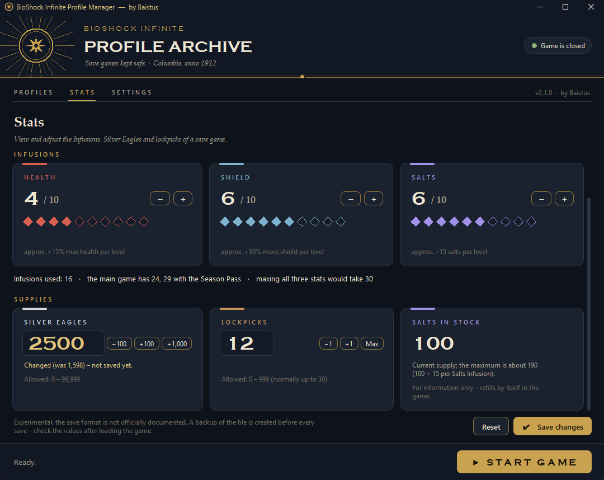

# BioShock Infinite Profile Manager

**by Baistus** · [Deutsche Version](README.de.md)

A small Windows tool for **BioShock Infinite** (Steam, app ID 8870):

- **Profiles:** keep several independent save games. The game only has one save slot, and “New Game” overwrites it. This tool backs up the save folder per profile and swaps it when you switch.
- **Stats editor (experimental):** view and change your **Infusions** (Health, Shield, Salts), **Silver Eagles** and **lockpicks** directly in a save game.

Every change creates a backup first. The UI is available in **English and German**.


---

## ⚠ Important: turn off Steam Cloud

Before using the tool, turn off Steam Cloud for BioShock Infinite. Otherwise Steam may overwrite your profiles:

1. Open Steam → **Library**
2. Right-click **BioShock Infinite** → **Properties …**
3. **General** tab → turn off **“Keep games saves in the Steam Cloud”**

**Why:** the tool swaps the files in the save folder. While Steam Cloud is active, Steam may restore older cloud saves on the next launch.

---

## Download & start

- **Easiest:** download `BioShockProfileManager.exe` from the [Releases](../../releases) page and run it. No installation or Python needed.
  - The exe is not signed, so Windows SmartScreen may warn you on the first start. Click “More info” → “Run anyway”.
- **From source:** you need Windows and Python 3.8+ (from python.org, Tkinter included). No other packages are required.

  ```bat
  python bioshock_profiles.py
  ```

## Profiles

| Action | What happens |
|---|---|
| **New profile …** | Creates a backup and saves the current state into the active profile. Then it empties the save folder, so the game offers a new game. |
| **Switch** (or double-click) | Backup, save the current state, then copy the selected profile into the save folder. |
| **Save current state** | Copies the save folder into the active profile. |
| **Rename … / Delete …** | Delete asks for confirmation and makes a backup first. The active profile cannot be deleted. |
| **Start game** | Opens `steam://rungameid/8870`. |

While `BioShockInfinite.exe` is running, switching, creating profiles and editing stats are locked. On first start, your existing save is imported as the profile **“Standard”**.

## Stats editor (experimental)



Pick a profile and a save. The latest autosave, which the game loads via **Continue**, is preselected.

- **Infusions:** each stat has 0–10 levels. Use **− / +** or click the diamonds.
  - The main game contains **24 Infusions**, **29 with the Season Pass**. Maxing all three stats would take 30, which is impossible in normal play.
  - A maxed stat can no longer be chosen at the next Infusion.
  - With **all three maxed**, you most likely cannot pick up Infusions anymore. At the **Blue Ribbon** the game can then get stuck, because the waitress only moves on once you have taken the Infusions. The tool warns you about this; keep one stat at 9 while you are still collecting Infusions.
- **Silver Eagles:** 0–99,999. Type the number or use the step buttons.
- **Lockpicks:** 0–999. The game's normal limit is 30; values above that are trainer territory and trigger a warning.
- **Salts in stock** is shown for information only.

Values above the normal maximum, such as Health level 1000, usually come from trainers or cheats. The tool shows them and lets you correct them.

**How it works:**
- Only these fields are changed in the player state of the save.
- The file keeps its size and timestamp, and its MD5 checksum is recalculated.
- The result is verified by re-reading it, and the original file is backed up to `_backups\…_Spielwerte\` first.
- The format was reverse-engineered from real saves. It is not officially documented.
- The Silver Eagles field is confirmed. The lockpick field was identified by analysis: **please report back if lockpicks show a different value in game.**

**Limits:**
- Only the main game is supported, not *Burial at Sea*.
- An Infusion stat can only be changed after you have chosen that Infusion type in the game at least once.

## Where things are stored

| What | Location |
|---|---|
| Save folder (auto-detected) | `Steam\userdata\<Steam ID>\8870\remote` or `Documents\My Games\BioShock Infinite\SaveData` |
| Profiles | `Documents\BioShockProfiles\<profile name>\` |
| Backups | `Documents\BioShockProfiles\_backups\<timestamp>_<action>\`, each with an `info.txt` |
| Settings / log / cache | `Documents\BioShockProfiles\config.json`, `manager.log`, `_cache\` |

**Restoring a backup:** quit the game, then copy the contents of `live\` (or `profil_<name>\`) from the backup folder back to the save folder (or profile folder). Each backup is about the size of your save folder (roughly 25 MB), so clean up `_backups` now and then.

The header shows the official game logo if your local Steam library cache has it (`Steam\appcache\librarycache\8870\logo.png`). The logo is read at runtime and is not part of this project. Without it, the tool shows its own emblem.

## Building the exe

```bat
build.bat
```

This creates `dist\BioShockProfileManager.exe` (single file, with icon and version info). PyInstaller is installed into a separate build environment under `%LOCALAPPDATA%\BioShockProfileManager\`, so your Python installation stays untouched.

## Tests

```bat
python -m unittest test_bioshock_profiles -v
```

The tests only use temporary dummy folders and synthetic save files. One test also checks that every UI text has an English translation.

## Notes

- The code is a single file, `bioshock_profiles.py`, written for Python 3.8+ with the standard library only. Code comments are in German.
- Unofficial fan project, not affiliated with or endorsed by 2K, Irrational Games or Take-Two Interactive. BioShock is a trademark of Take-Two Interactive Software, Inc. No game assets are included.
- License: [MIT](LICENSE) © 2026 Baistus
